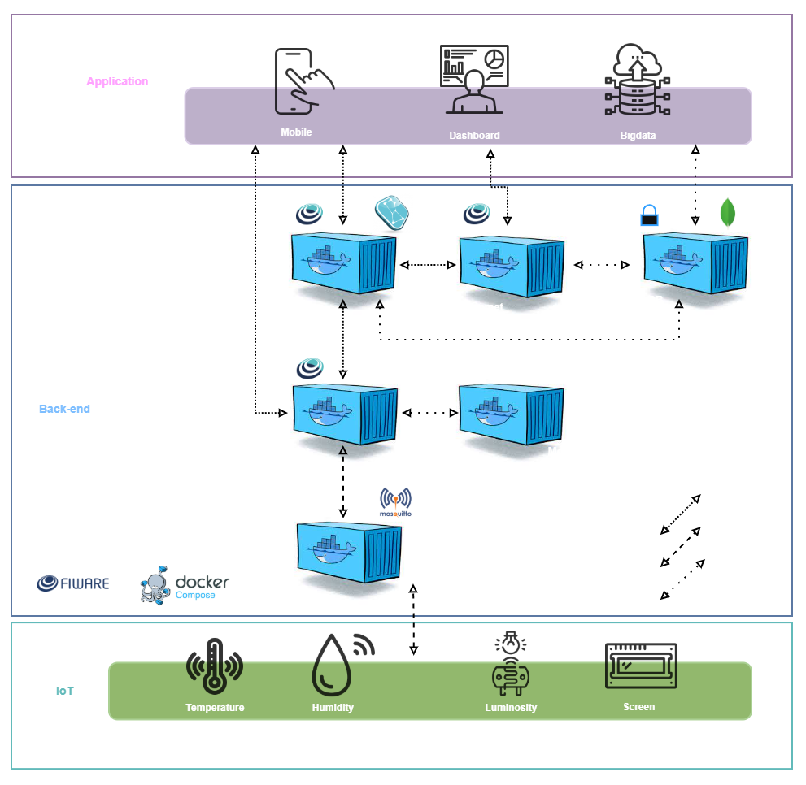

# Monitoramento de Vinheria - IOT

Aplicação web para monitorar as condições ambientais de uma vinheria por meio de dispositivos IoT conectados ao ecossistema FIWARE. O painel acompanha luminosidade, temperatura e umidade no ambiente de armazenamento, mantém histórico das leituras e permite configurar limites com alertas pelo Telegram. A telemetria pode vir de dispositivos físicos com ESP32 ou de uma simulação no Wokwi. O controle de estado e os comandos de lâmpada fazem parte da integração disponível no sistema.

## Links do projeto

- **Página da aplicação:** [https://vinheria-full-tau.vercel.app/](https://vinheria-full-tau.vercel.app/)
- **Simulação Wokwi:** [https://wokwi.com/projects/477370841593852929](https://wokwi.com/projects/477370841593852929)
- **Repositório FIWARE usado como referência:** [fabiocabrini/fiware](https://github.com/fabiocabrini/fiware)

## Descrição da solução

O sistema de monitoramento da vinheria é um dashboard responsivo que centraliza as leituras ambientais dos pontos monitorados. Temperatura, umidade e luminosidade ajudam a equipe a acompanhar as condições do espaço de armazenamento e identificar variações fora das faixas definidas. O usuário informa o endereço IPv4 do servidor FIWARE pela interface. O navegador consulta o painel a cada cinco segundos; os dados são agregados a partir das entidades do Orion Context Broker e dos dispositivos provisionados no IoT Agent.

A interface oferece três áreas principais:

- **Visão geral:** situação dos pontos/dispositivos monitorados e indicadores das condições ambientais, com acesso aos comandos de lâmpada disponíveis. O estado pode aparecer como desconhecido até o dispositivo reportar uma leitura.
- **Monitoramento e histórico:** leitura atual e gráficos de luminosidade, temperatura e umidade. O painel ativa uma assinatura no Orion para encaminhar atualizações ao STH-Comet e busca até 30 pontos por atributo, atualizando a tela a cada dez segundos enquanto a visualização ao vivo estiver ativa.
- **Dispositivos:** cadastro e remoção dos dispositivos IoT no IoT Agent/Orion, além de trechos para testar comandos pelo Postman ou enviar telemetria por MQTT.

É possível configurar limites mínimo e máximo por métrica e dispositivo/ponto monitorado. Quando um valor ultrapassa um limite, o navegador envia uma notificação ao Telegram. O token do bot, o Chat ID e os limites são guardados no `localStorage` do navegador. A lista de atividade do painel é temporária e mantida em memória durante a sessão.

### Atributos e convenções FIWARE

- Tipo de entidade: `Lamp`.
- Prefixo de ID: `urn:ngsi-ld:Lamp:` (por exemplo, `urn:ngsi-ld:Lamp:003`).
- Namespace FIWARE enviado pelo proxy: `fiware-service: smart`, `fiware-servicepath: /`.
- Atributos de telemetria: `state`, `luminosity`, `temperature`, `humidity` e `TimeInstant`.
- Comandos: `on` e `off`.
- Protocolo/transport do dispositivo registrado pelo painel: `PDI-IoTA-UltraLight` sobre MQTT.
- Tópicos de exemplo para o dispositivo `lamp003`, assumindo a apikey padrão `TEF`: `/TEF/lamp003/cmd`, `/TEF/lamp003/attrs/l` (luminosidade) e `/TEF/lamp003/attrs/s` (estado).

## Arquitetura em camadas

<p align="center">

</p>

**Fluxo de telemetria:** sensores instalados no ambiente da vinheria são lidos pelo ESP32/simulador e publicados via MQTT → IoT Agent traduz o protocolo e atualiza a entidade `Lamp` no Orion → uma assinatura encaminha mudanças de luminosidade, temperatura e umidade ao STH-Comet → o painel apresenta leituras, gráficos e alertas para acompanhamento das condições do espaço.

**Fluxo de comando:** usuário aciona ligar/desligar → frontend solicita `PATCH` à rota `/api/fiware` → proxy encaminha o pedido ao Orion → registro de comandos entrega a instrução ao IoT Agent → dispositivo recebe o comando no tópico MQTT `/cmd`.

O proxy FIWARE aceita somente IP IPv4 e portas `1026`, `4041` ou `8666`, valida caminho e método e usa timeout de dez segundos. A porta MQTT `1883` é usada diretamente pelos dispositivos/simulador para alcançar o Mosquitto e não passa por esse proxy HTTP. Ele encaminha as chamadas do servidor Next.js para os serviços FIWARE, evitando chamadas diretas do navegador a origens distintas. A rota Telegram encaminha mensagens ao Bot API.

## Manual de instalação e operação

### Requisitos de software

- Node.js compatível com Next.js 15 (recomenda-se Node.js 20 LTS).
- npm (incluído com Node.js) ou pnpm.
- Instância FIWARE acessível pelo servidor que executa o Next.js, com Orion Context Broker (`1026`), Mosquitto MQTT (`1883`), IoT Agent (`4041`) e STH-Comet (`8666`).
- Para alertas: bot Telegram válido e Chat ID.

### Instalação da plataforma FIWARE

**FIWARE Descomplicado** foi O material utilizado como referência, baseado em Docker, contendo componentes como Orion Context Broker, IoT Agent MQTT, STH-Comet, MongoDB e Eclipse Mosquitto.

Para executar o FIWARE Descomplicado, utilize a plataforma AWS para iniciar um servidor com sistema Ubunto.

**Recursos mínimos recomendados para o host FIWARE:** 1 vCPU, 1 GB de RAM e 20 GB de armazenamento (o espaço necessário cresce conforme o volume e a retenção do histórico).

Instale os pré-requisitos no Ubuntu, conforme Repositório FIWARE usado como referência [fabiocabrini/fiware](https://github.com/fabiocabrini/fiware):

```bash
sudo apt update
sudo apt install docker.io
sudo apt install docker-compose
```

Baixe e inicie a stack:

```bash
git clone https://github.com/fabiocabrini/fiware
cd fiware
sudo docker-compose up -d
```

Confira os containers e os logs com `sudo docker ps` e `sudo docker-compose logs -f`. Para encerrar a stack, mantendo os dados persistidos nos volumes:

```bash
sudo docker-compose down
```

**Portas e conectividade da stack:**

| Porta | Serviço | Uso neste projeto |
| ---: | --- | --- |
| `1026/TCP` | Orion Context Broker | Consultas e comandos NGSI-v2 |
| `1883/TCP` | Eclipse Mosquitto | Conexão MQTT do ESP32/Wokwi com o IoT Agent |
| `4041/TCP` | IoT Agent MQTT | Provisionamento e consulta de dispositivos |
| `8666/TCP` | STH-Comet | Consulta do histórico e recebimento de notificações |
| `27017/TCP` | MongoDB | Persistência interna da plataforma |

O dashboard usa NGSI-v2 e o serviço Orion como broker de contexto: entidades e atributos representam o estado atual da vinheria; assinaturas notificam mudanças; o STH-Comet mantém e consulta séries históricas. O IoT Agent traduz mensagens MQTT dos dispositivos em atualizações NGSI, enquanto o Mosquitto recebe e publica mensagens para ESP32 e simulação. O MongoDB sustenta a persistência interna da stack.

### Instalação do painel

### 1. Clonar o repositório

```bash
git clone https://github.com/asia-devv/Vinheria-Full.git
```

Entre na pasta:

```bash
cd Vinheria-Full
```

### 2. Instalar as dependências

```bash
npm install
```

### 3. Executar

```bash
npm run dev
```

A aplicação será disponibilizada pelo em um endereço semelhante a:

```text
http://localhost:3000
```

### Acesso à página por tag NFC

Uma tag NFC pode servir como atalho para abrir o painel da vinheria em um celular compatível. Grave na tag um registro NDEF do tipo **URI** contendo o endereço web onde o painel está publicado, por exemplo `https://vinheria-full-tau.vercel.app/`.

1. Publique e inicie o painel em um endereço alcançável pelo celular. Não grave `localhost` ou `127.0.0.1`: esses endereços apontam para o próprio celular, não para o computador que hospeda a aplicação.
2. Use um celular com NFC e um aplicativo de gravação de tags para gravar o endereço como registro NDEF URI em uma tag NFC compatível.
3. Aproxime o celular da tag e aceite a abertura do link no navegador. A tag apenas abre a página; ela não autentica o usuário nem configura automaticamente os serviços.
4. No primeiro acesso em cada navegador, informe o IP do servidor FIWARE na barra lateral e conecte. Essa configuração é salva localmente naquele navegador. Cada usuário deve ter conectividade de rede até o painel e o servidor FIWARE.

### Configuração do FIWARE e uso

1. Confirme que Orion, IoT Agent e STH-Comet estão em execução e que o servidor do painel consegue alcançá-los. Libere as portas `1026`, `1883`, `4041` e `8666` somente para as origens que precisam acessá-las.
2. Na barra lateral do painel, informe o IPv4 público ou privado do host FIWARE, por exemplo `98.91.20.39:1026`, e selecione **Conectar**. A porta base do Orion é `1026`; o painel deriva as portas `4041` e `8666` para os outros serviços.
3. Em **Dispositivos**, cadastre um ID alfanumérico (por exemplo, `003`). O painel registra `lamp003` no IoT Agent e cria/verifica o registro de comandos no Orion. Entidades que já existam no Orion também podem aparecer antes do provisionamento.
4. Instale os sensores nos pontos da vinheria que deseja acompanhar e publique telemetria do ESP32 ou Wokwi usando o broker, apikey e formato UltraLight configurados no IoT Agent. O projeto espera os atributos de estado (`s`), luminosidade (`l`), temperatura (`t`) e umidade (`h`); confira os mapeamentos do dispositivo no ambiente usado.
5. Use **Visão geral** para acompanhar estado e enviar comandos; use **Monitoramento e histórico** para consultar gráficos e leituras históricas. O histórico começa a ser armazenado quando há novas atualizações após a assinatura estar ativa.
6. Em **Dispositivos**, configure token e Chat ID do Telegram e, em cada lâmpada, defina limites mínimo/máximo. Mantenha o painel aberto no navegador para que o monitoramento periódico e os alertas sejam executados.
7. A remoção de um dispositivo apaga o dispositivo do IoT Agent, registros de comando relacionados no Orion e a entidade. Confirme a ação antes de prosseguir.

### Hardware e conectividade

O firmware implementa monitoramento ambiental para a vinheria com ESP32, DHT11, LDR, sinalização local por LEDs/buzzer, botões e display LCD I2C.

#### Componentes usados pelo firmware

- Placa ESP32 com Wi-Fi.
- Sensor DHT11 para temperatura e umidade relativa.
- LDR (fotoresistor) para medir luminosidade.
- Display LCD 16×2 com interface I2C, endereço.
- Três LEDs: amarelo (atenção), verde (condição normal) e vermelho (alerta crítico).
- Buzzer ativo para sinal sonoro em alerta crítico.
- Dois botões: ligar e desligar o estado do sistema.

#### Comportamento local do monitor

O ESP32 lê os sensores aproximadamente a cada segundo e publica telemetria MQTT a cada cinco segundos. A luminosidade é convertida pelo código para uma escala de `0–100`; temperatura é enviada em °C e umidade em porcentagem relativa. O display apresenta temperatura e umidade, e o firmware sinaliza as condições com LEDs e buzzer: verde para faixa normal, amarelo para atenção e vermelho com buzzer para situação crítica.

Os botões e comandos MQTT alteram a variável de estado do sistema (`on`/`off`) e a sinalização/display. No estado `off`, as leituras e a publicação periódica dos sensores continuam no firmware.

#### Software e gravação do firmware

Use Arduino IDE com suporte à placa ESP32 e instale as bibliotecas `DHT sensor library`, `LiquidCrystal_I2C` e `PubSubClient` (e `Adafruit Unified Sensor`, exigida pela biblioteca DHT). Abra `sketch.ino`, selecione a placa/porta serial corretas e grave o sketch. O monitor serial opera a `115200` baud e informa conexão Wi-Fi/MQTT e leituras.

Antes de gravar em uma placa física, ajuste no início do arquivo:

- `WIFI_SSID` e `WIFI_PASSWORD` para a rede Wi-Fi disponível. Os valores atuais (`Wokwi-GUEST` e senha vazia) são próprios da simulação Wokwi.
- `MQTT_BROKER` para o endereço do host Mosquitto usado pelo IoT Agent e `MQTT_PORT` para a porta MQTT (`1883` na configuração atual). O valor atual é `184.195.90.61`.
- `DEVICE` para o identificador provisionado no IoT Agent. O padrão `003` produz o dispositivo `lamp003` e o client ID MQTT `fiware_003`.

O ESP32 precisa ter saída de rede até o broker na porta TCP `1883`. O servidor FIWARE precisa ter o IoT Agent conectado ao mesmo Mosquitto e o dispositivo cadastrado com tipo `Lamp`, protocolo UltraLight e os mapeamentos de atributos esperados (`s`, `l`, `t`, `h`). Para a telemetria do dispositivo chegar ao painel, o `DEVICE`, o registro do IoT Agent e a entidade consultada pelo Orion devem usar o mesmo ID. A URL/host configurada no painel aponta para os serviços Orion, IoT Agent e STH-Comet; o broker MQTT é configurado separadamente no firmware.

#### Tópicos MQTT usados

Com `DEVICE = "003"`, o sketch assina o tópico de comandos e publica estado, sensores e confirmação nos seguintes tópicos, usando a apikey `TEF` codificada no firmware:

| Tópico | Direção | Conteúdo |
| --- | --- | --- |
| `/TEF/lamp003/cmd` | Broker → ESP32 | Comandos `on`/`off` encaminhados pelo IoT Agent |
| `/TEF/lamp003/attrs` | ESP32 → broker | Estado do monitor (`s|on` ou `s|off`) |
| `/TEF/lamp003/attrs/l` | ESP32 → broker | Luminosidade (`0–100`) |
| `/TEF/lamp003/attrs/t` | ESP32 → broker | Temperatura em °C |
| `/TEF/lamp003/attrs/h` | ESP32 → broker | Umidade relativa em `%` |
| `/TEF/lamp003/cmdexe` | ESP32 → broker | Resposta de execução do comando (`lamp003@on|ok` / `lamp003@off|ok`) |

Ao mudar o identificador `DEVICE`, os tópicos são montados novamente como `lamp<ID>`. Atualize também o ID cadastrado na interface/IoT Agent e confirme que a apikey `TEF`, o broker e os mapeamentos de atributos correspondem à instalação FIWARE utilizada.

### Diagnóstico

- **Sem resposta do FIWARE:** confira o IP informado, disponibilidade do host, portas `1026`, `4041` e `8666`, firewall/security group e se o processo Next.js tem rota até o servidor. Para falhas de telemetria, verifique também MQTT `1883`.
- **Dispositivo aparece só no Orion:** confira o provisionamento no IoT Agent e o `entity_type` `Lamp`.
- **Comando remoto não chega ao ESP32:** valide o registro no Orion, o broker/apikey, o tópico `/cmd`, a conexão MQTT do ESP32 e o firmware. O sketch não controla uma lâmpada física.
- **Sem histórico:** confirme que novas telemetrias estão sendo enviadas e que o STH-Comet recebe notificações do Orion no endereço configurado. Dados anteriores à assinatura não são necessariamente recuperados.
- **Telegram sem alerta:** confirme token, Chat ID, valores recebidos e limites. O navegador deve permanecer aberto; as configurações ficam no armazenamento local do navegador.

## Tecnologias

- Next.js 15, React 19 e TypeScript
- Tailwind CSS e componentes Radix UI
- SWR para atualização periódica dos dados
- Recharts para gráficos
- FIWARE Orion Context Broker, IoT Agent e STH-Comet
- MQTT para comunicação com dispositivos
- Telegram Bot API para alertas

## Integrantes

| Integrante | RM |
| --- | ---: |
| Bernardo Kim | 568968 |
| Leonardo Daniel | 574142 |
| Matheus Tamataya | 572842 |
| Vinycius Lu | 569300 |